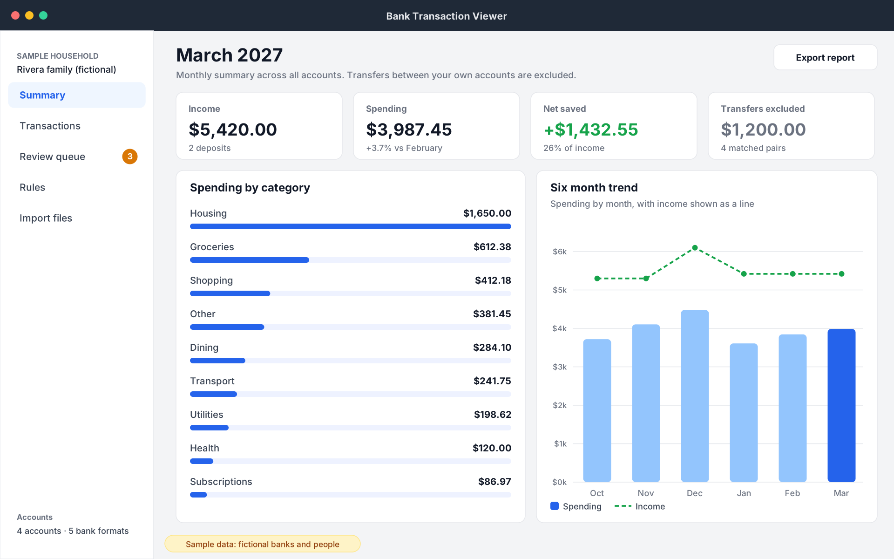

# Bank Transaction Viewer: a four week build

A hands on workshop for Hillsborough College students, Monday evenings at 7pm.
In four sessions you build a small, really usable tool: it takes messy CSV exports
from five banks, **structures** them into one clean format, and **views** them in a browser.



Everything here is fictional. The banks, the Rivera family and every number were made up by `data/generate_mock_data.py`.

## Two programs, one contract

```
data/raw/*.csv  ──►  STRUCTURER  ──►  out/transactions.json  ──►  VIEWER (browser)
 five messy banks     (you write it,     one clean shape,          summary, ledger,
                       any language)      see contract/            review queue
```

The file in the middle is the contract (`contract/CONTRACT.md` and `contract/transaction.schema.json`).
Because both sides agree on it, you can write the structurer in Python, Java, C#, JavaScript or anything else,
and `tools/check.py` can grade it the same way.

## The schedule

| Week | Date | You build | Check |
|---|---|---|---|
| 0 | Mon Jan 25 | Setup night with Andy: install tools, clone this repo | `python tools/check.py --week 1` (setup lines pass) |
| 1 | Mon Feb 1 | [Meet the data, read one bank](weeks/week-1/README.md) | `--week 1` |
| 2 | Mon Feb 8 | [Five banks, one shape](weeks/week-2/README.md) | `--week 2` |
| 3 | Mon Feb 22 | [Categories, transfers and a review queue](weeks/week-3/README.md) | `--week 3` |
| 4 | Mon Mar 1 | [The viewer, and your first release](weeks/week-4/README.md) | `--week 4` |
| 5 | Mon Mar 8 | [Open lab (optional)](weeks/week-5-open-lab/README.md) | `--week 5` |

## CI and CD, done through AI

Each week also adds one piece of a real delivery pipeline: tests on every push (CI) in weeks 1 to 3,
and an automatic deploy of your viewer when you tag a release (CD) in week 4. You ask your AI agent to
write each GitHub Actions workflow with a prompt from the week guide, then review it with a checklist.
If Actions does not start, `python tools/ci_local.py --week N` runs the same pipeline on your computer.
See [docs/CI_CD.md](docs/CI_CD.md).

## Quick start

You need Python 3.10 or newer and git ([docs/SETUP.md](docs/SETUP.md)). Nothing else to install.

```
git clone <this repo>
cd hcc-bank-viewer-workshop
python tools/check.py --week 1          # setup check
python tools/start_my_work.py python    # your own copy of the starter
python my-work/python/structure.py      # run it
```

Then open [weeks/week-1/README.md](weeks/week-1/README.md) and go step by step.

Want to see the finished thing first?

```
python reference/python/structure.py
python tools/serve.py                   # opens the reference viewer
```

On Windows, if `python` is not found, try `py` instead.

## Why this stack

We picked the simplest tools that still make a real app:

- **Python, standard library only.** It reads like plain English, comes with `csv`, `json` and `decimal`,
  and needs no `pip install`. Nobody loses a night to a broken install.
- **A plain HTML, CSS and JavaScript viewer.** No framework and no build step: every browser already runs it,
  and you can read every line. The only helper is `tools/serve.py`, a tiny local web server.
- **A language neutral contract.** You can choose any language for the structurer; the checker only reads the output file.
  A Java reference is included because some of you know Java from class.
- **AI is optional.** Rules do most of the work. An AI can suggest a category for the leftovers, but a person approves it.
  Everything works with no API key.

## Map of the repo

| Folder | What is in it |
|---|---|
| `weeks/` | One guide per session: goals, steps, checkpoints, a "Stuck?" table, what to commit |
| `contract/` | The data contract, its JSON schema, the account list and the starter rules |
| `data/` | The fake bank exports (`raw/`), answer keys, a bonus bank, a sample output and the generator |
| `starter/` | Skeletons with TODOs (Python, Java, viewer). Copy them with `tools/start_my_work.py` |
| `my-work/` | Yours. Created when you run `start_my_work.py` |
| `reference/` | Finished versions (Python, Java, viewer, CI and CD workflows). Peek when stuck, then write your own |
| `tools/` | `check.py` (weekly checks), `ci_local.py` (the pipeline on your computer), `build_site.py`, `serve.py`, `show_totals.py`, `start_my_work.py`, `selftest.py` |
| `docs/` | Setup guide, CI and CD guide, instructor notes, mockups |

## Using an AI coding agent?

That is fine, and it is a skill worth practicing. Point your agent at [AGENTS.md](AGENTS.md).
It tells any agent to build in `my-work/`, explain each step to you and run the checks,
instead of copying the reference. The goal is code you can explain yourself.
